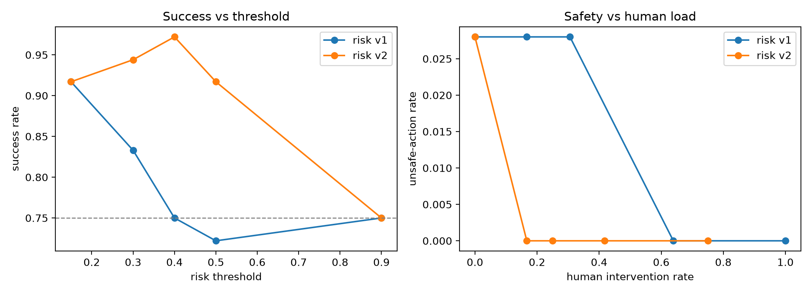

# Project Approach: Risk-Aware Adaptive Autonomy for Network Remediation

This document outlines the architectural and experimental approach used to implement the Network Remediation Agent.

> **Status: the first round of results did not hold up, and the fix is in this
> repository.** The v1 benchmark said "adaptive autonomy matches full-auto on
> success at 25% of the human load". Re-running the audit showed the opposite:
> the router escalated the *correct* plans and auto-executed *every* wrong one.
> Section 4 is the audit; section 5 is what changed; section 6 is the corrected
> results.

## 1. System Architecture

The system follows a decoupled "Observe → Propose → Route → Execute" pipeline to ensure safety and transparency.

### A. Observation Layer (MCP)
- **Protocol**: Uses the Model Context Protocol (MCP) to provide the LLM agent with a standardized set of tools.
- **Toolset**: `list_services`, `get_health`, `get_metrics`, `get_logs`, and `get_config`.
- **Constraint**: The MCP server **does not** expose any mutation tools. The LLM can only *propose* a fix, not execute it.

### B. Intelligence Layer (Agents)
- **LLM Agent**: A reasoning agent (Gemini 3.5 Flash-Lite) that follows a structured workflow: Survey → Diagnose → Map to Rubric → Propose.
- **Heuristic Agent**: A deterministic baseline with a tunable error rate used to validate the risk layer's ability to catch misdiagnoses.

### C. Risk & Policy Layer
Every proposed plan is passed through a risk scorer before execution.

**Risk Formula (v2, current):**
$$\text{Risk} = w_c(1-\text{conf}) + w_i \cdot \text{impact} + w_b \cdot \text{blast}_{eff} + w_r(1-\text{rev}) + w_x(1-\text{rubric})$$

with $w_c{=}0.20$, $w_i{=}0.15$, $w_b{=}0.20$, $w_r{=}0.10$, $w_x{=}0.35$.

- **Confidence Calibration**: LLM confidence is blended with an "evidence agreement" score (do metrics match the claimed fault?) to reduce over-confidence.
- **Rubric Consistency** *(new)*: does the proposed action match the published runbook for the fault the agent *claimed*? A plan that says "HIGH_LATENCY → restart_service" contradicts the runbook, and neither the confidence nor the evidence term can see that.
- **Context-Aware Blast Radius** *(new)*: restarting a shared dependency that was not even down knocks out its dependents.
- **Routing Policies**:
    - `full-auto`: Immediate execution.
    - `full-human`: Always requires human approval.
    - `adaptive`: Executes automatically if $\text{Risk} < \text{Threshold}$, otherwise routes to a human.

The v1 formula is kept for the ablation and is selected with `RISK_VERSION=v1`.
Every run row carries **both** scores (`risk_score_v1`, `risk_score_v2`) so any
recorded run can be re-analysed under either formula.

### D. Execution Layer
- **Executor**: The only component capable of mutating the Docker testbed.
- **Testbed**: A multi-service environment where faults (CRASH, HIGH_LATENCY, PACKET_LOSS, CONFIG_DRIFT) are injected, with **service-a as a shared dependency** of service-b and service-c.

---

## 2. Methodology

### A. Paired Experimental Design
To eliminate LLM randomness as a variable, we use a **paired design**:
1. A scenario is injected.
2. The agent generates a **single plan**.
3. That **identical plan** is replayed across all three policies.
4. Differences in outcomes are attributed solely to the **Policy**, not the LLM.

The simulated operator is seeded per *diagnosis*, so the same plan gets the same
verdict under every policy and the only thing that varies is the routing. (In
v1 a single operator was shared across the whole run, so `full-human` and
`adaptive` drew from different positions of the same random stream and the same
plan could get different verdicts under different policies — a small but real
violation of the paired design. Fixed; see METHODOLOGY.md 5.A.)

Because the design is paired, policy comparisons use **McNemar's exact test** on
the discordant pairs rather than a comparison of independent rates.

### B. Simulated Human Operator
To avoid "Perfect Oracle" bias, the simulated human is a stochastic agent:
- **Catch Rates**: Probabilities for catching incorrect plans ($\alpha_{incorrect}$) vs. correct-but-dangerous plans ($\alpha_{unsafe}$).
- **False Rejection Rate ($\beta$)**: Models the probability that a human rejects a safe/correct plan, adding to MTTR.
- **Alert Fatigue**: Review accuracy is a function of review load. High load (e.g., `full-human`) increases false rejections and decreases catch rates.
- **Imperfect Recovery**: Manual fixes have a failure probability (e.g., 5%), reflecting real-world operator error.

### C. Operational Metrics
1. **Success Rate**: Percentage of runs where the target service recovered.
2. **MTTR**: Average time to recovery (including decision latency and human wait time).
3. **Incorrect Action Rate**: Frequency of plans that had no effect on the target.
4. **Unsafe Action Rate**: Frequency of plans causing measured collateral damage in non-target services.
5. **Human Intervention Rate**: Percentage of runs requiring human approval.
6. **Decision Latency**: Wall-clock time the agent spent diagnosing.
7. **MCP Tool Calls**: Number of MCP tool calls per incident (communication overhead).

Every rate is reported with a 95% Wilson interval, and every policy comparison
with a paired McNemar exact test, because the design is paired and n is small.
See `METHODOLOGY.md` for the full specification and section 6 for the threats to
validity.

---

## 3. Implementation Stack
- **Backend**: Python 3.11+, FastAPI, MCP SDK.
- **Frontend**: React + Vite.
- **Infrastructure**: Docker & Docker Compose.
- **LLM**: Gemini 3.5 Flash-Lite (via `google-genai` SDK).

---

## 4. The Escalation Audit (why the v1 results were wrong)

The v1 benchmark reported 75% success for both `full-auto` and `adaptive`, with
`adaptive` spending 25% of the human budget. The obvious reading was "the risk
router is neutral: it cuts human load without losing success". The audit
(`python -m eval.audit results/runs_final_benchmark.jsonl`) says otherwise.

### 4.1 What the router escalated

All **9 escalated runs were successes**, and all **9 failures were auto-executed**:

| | escalated (human) | auto-executed |
| :--- | :---: | :---: |
| runs | 9 | 27 |
| **failures** | **0** | **9** |
| wrong plans | 0 | 9 |

The 9 escalations were the three `PACKET_LOSS` scenarios (all correct
`reroute_traffic` plans). The 9 failures were the three `HIGH_LATENCY`
scenarios, where the LLM named the right fault but picked the wrong remedy
(`restart_service` / `scale_service`).

### 4.2 The risk scores overlap — and point the wrong way

| | n | min | max | mean |
| :--- | :---: | :---: | :---: | :---: |
| failed plans | 9 | 0.1563 | 0.3375 | 0.2466 |
| successful plans | 27 | 0.1563 | 0.5813 | 0.3465 |

- Overlap region: **[0.1563, 0.3375]** — 9/9 failed plans sit inside the successful range, and 15/27 successful plans sit inside the failed range.
- **AUC(risk → failure) = 0.317.** Below 0.5 means the score is *anti*-correlated with failure: a *lower* risk score was more likely to be a wrong plan.
- 0/9 failures scored above the 0.40 threshold. 9/27 correct plans did.

**Root cause.** The v1 formula scores how *dangerous* an action is on a service,
not whether the action is *valid* for the fault. Three of its four inputs are
static functions of (service, action): blast radius, impact, reversibility. The
fourth, confidence, could not help either — the LLM reported 0.80–0.95 confidence
on its wrong plans, and `evidence_agreement` only validates the *claimed fault*,
never the *remedy*. The agent had diagnosed `HIGH_LATENCY` correctly and then
proposed `restart_service`; nothing in the formula noticed.

### 4.3 The "0.0% unsafe rate" was an artifact

Collateral damage in the v1 testbed fired only when a `reroute_traffic` misfired.
The LLM's 9 wrong plans were `restart_service` and `scale_service`, neither of
which can misfire. So **no wrong plan the LLM made was capable of causing
collateral damage** — the 0.0% unsafe rate measured the action mix, not the
safety of the system. The risk layer had no job to do, because nothing could go
wrong.

---

## 5. What changed

| # | Problem | Fix |
| :--- | :--- | :--- |
| 1 | Risk formula cannot separate correct from incorrect plans | v2 adds a **rubric-consistency** term (the plan vs. the published runbook for the fault the agent *claimed*) and a **context-aware blast radius** |
| 2 | Wrong actions could not cause collateral damage | `service-a` is now a **shared dependency**: a gratuitous restart degrades service-b and service-c |
| 3 | "0.0% unsafe" was unmeasurable | Collateral damage is now **measured** against a health snapshot taken just before the action |
| 4 | `incorrect_action` was `True` for 100% of runs | `faults.is_incorrect` read a `recovered` key the executor never emitted; it now reads the action's `effective` flag |
| 5 | Alert fatigue never fired | `operator.review()` was called without `review_load`, so `full-human` and `adaptive` had identical operator accuracy |
| 6 | `remediation/operator_model.py` was dead code | It was missing its imports (`random`, `FIX_MATRIX`) and duplicated inside `orchestrator.py`; it is now the single source of truth |
| 7 | The threshold sweep modelled "unsafe iff wrong" | `eval/sweep.py` now **replays** the recorded diagnoses: it re-routes them, re-simulates the operator, and replays the escalation path (approve → the plan runs; reject → the operator fixes it by hand, which can fail) |
| 8 | Results table omitted latency and tool calls | Both are now columns in `eval/metrics.py` and in the table below |
| 9 | The paired design was not actually paired | The operator is now seeded per *diagnosis*, so the same plan gets the same verdict under every policy |
| 10 | An action against a downed service raised | `executor` now treats "the service is unreachable" as an ineffective action instead of an exception (this was silently turning runs into errors) |
| 11 | The collateral check flagged pure latency jitter | The 1.5x ratio test now needs an absolute 100ms floor; the services jitter by a few ms between samples |

### The v2 formula is a consistency check, not an oracle

The rubric term compares the plan against `config.REMEDIATION_RUBRIC` — the same
runbook that is handed to the LLM in the system prompt — and it is applied only
to the fault the **agent itself claimed**. It never sees the injected fault, so a
plan that names the wrong fault but proposes the right action still passes.
`tests/test_risk.py::test_risk_layer_never_reads_the_evaluation_oracle` asserts
by AST inspection that `risk.py` never imports the ground-truth `FIX_MATRIX`.

### The weight is not knife-edge

The rubric weight is the only free parameter. `python -m eval.sensitivity` sweeps it:

| w_rubric | AUC | wrong plans caught | wrong plans missed | correct plans needlessly escalated | human load |
| ---: | ---: | ---: | ---: | ---: | ---: |
| 0.00 (≈ v1) | 0.451 | 3 | 6 | 9 | 0.333 |
| 0.10 | 0.691 | 3 | 6 | 6 | 0.250 |
| 0.20 | 0.889 | 6 | 3 | 3 | 0.250 |
| 0.25 | 0.975 | 7 | 2 | 3 | 0.278 |
| **0.30 – 0.80** | **1.000** | **9** | **0** | **0** | **0.250** |
| v1 (for reference) | 0.438 | 3 | 6 | 9 | 0.333 |

Any rubric weight ≥ 0.30 separates the classes perfectly at the *same* 25% human
load. The shipped weight (0.35) sits in the middle of that plateau.

---

## 6. Results

### 6.1 v1 benchmark (the results that did not survive the audit)

| Policy | Success Rate | Avg MTTR (s) | Unsafe Rate | Intervention Rate | Decision Latency (s) | MCP Calls |
| :--- | :---: | :---: | :---: | :---: | :---: | :---: |
| **full-auto** | 75.0% | 18.78 | 0.0% | 0.0% | 18.37 | 7.5 |
| **full-human** | 97.2% | 146.39 | 0.0% | 100.0% | 18.37 | 7.5 |
| **adaptive** | 75.0% | 60.77 | 0.0% | 25.0% | 18.37 | 7.5 |

The "0.0% unsafe rate" and the "adaptive matches full-auto" reading are both
explained in section 4. The 0.0% is an artifact; the match is because the router
was escalating the wrong 25%.

### 6.2 v2 benchmark

LLM agent (Gemini 3.5 Flash-Lite), 12 scenarios x 3 repeats x 3 policies = 36 diagnoses,
new testbed, v2 risk formula, threshold 0.40.

| Policy | n | Success | 95% CI | MTTR (s) | Failed | Unsafe | 95% CI | Ineffective | Human | Decision latency (s) | MCP calls |
| :--- | ---: | ---: | :---: | ---: | ---: | ---: | :---: | ---: | ---: | ---: | ---: |
| **full-auto** | 36 | 75.0% | [59%, 86%] | 38.11 | 9 | 2.8% | [0%, 14%] | 11.1% | 0.0% | 38.85 | 7.56 |
| **adaptive** | 36 | **97.2%** | [82%, 98%] | 90.03 | 1 | **0.0%** | [0%, 10%] | 2.8% | 25.0% | 38.85 | 7.56 |
| **full-human** | 36 | 88.9% | [75%, 96%] | 162.65 | 4 | 0.0% | [0%, 10%] | 8.3% | 100.0% | 38.85 | 7.56 |

**What the v2 router did with the same 36 diagnoses:**

| | escalated to the human | auto-executed |
| :--- | :---: | ---: |
| v1 router | 9 — **all 9 correct** | 27 — **9 of them wrong** |
| v2 router | 9 — **all 9 wrong** | 27 — **0 wrong** |
| auto-executed failures | v1: 9/27 (33%) | **v2: 0/27 (0%)** |
| routing decisions correct | v1: 7/12 scenarios | **v2: 12/12 scenarios** |

Every wrong plan the LLM produced in this benchmark was routed to the human; not one
correct plan was. 8 of the 9 escalations were caught and fixed by the operator; the
ninth was approved by mistake and failed. The risk score is now **separable**:

| | n | min | max | mean |
| :--- | ---: | ---: | ---: | ---: |
| failed plans | 9 | 0.4500 | 0.6500 | 0.5483 |
| successful plans | 27 | 0.1000 | 0.3600 | 0.2138 |

Overlap region: **empty**. AUC(risk → failure) = **1.000** (v1: 0.317).
9/9 failed plans score above the threshold; 0/27 correct plans do.

**Paired test.** Because every diagnosis is replayed under all three policies, the
informative comparison is within-diagnosis. McNemar's exact test on the discordant
pairs: `full-auto` failed where `adaptive` recovered in **8** cases, and `adaptive`
failed where `full-auto` recovered in **0** — **p = 0.0078**.

**Collateral damage is now real.** Exactly one of the 9 wrong plans is of a shape
that can cause collateral: `s04` rep 1, `restart_service` on service-a — a
gratuitous restart of the shared dependency, which degrades service-b and
service-c. It fires in `full-auto` (2.8% unsafe). In `adaptive` and `full-human`
it never does, because the plan is escalated and rejected. The other 8 wrong
plans (`scale_service`, or restarts of the leaf services) are merely ineffective.

**Caveat on sample size.** With 36 runs per policy the *marginal* success rates have
wide intervals. The claims that are solid are the counts: 0/27 vs 9/27
auto-executed failures, 12/12 vs 7/12 correct routing decisions, and an AUC of
1.000 vs 0.317. The stress test in 6.4 uses 120 diagnoses per policy, where the
failure comparison is significant at p < 0.001.

**A baseline moved.** `full-human` is 88.9% here, not the 97.2% of the v1 table.
That is not a regression in the human: the v1 number was produced with
`review_load` hard-coded to 0, so the alert-fatigue model that METHODOLOGY.md
specifies never fired. It fires now. At full load the operator catches 72% of
wrong plans (not 90%) and falsely rejects 15% of good ones (not 5%). The
operator-load sensitivity is in section 6.5.

### 6.3 Threshold sweep

Sweeping the threshold over the same 36 LLM diagnoses, re-running every plan
**in Docker** at each threshold (`make sweep-live`; the offline replay in
`make sweep` reproduces these numbers, which is how the replay was validated):

**v1 — the original formula:**

| threshold | escalated | human load | success | unsafe | MTTR (s) |
| ---: | ---: | ---: | ---: | ---: | ---: |
| 0.15 | 36/36 | 100% | 91.7% | 0.0% | 166.0 |
| 0.30 | 23/36 | 63.9% | 83.3% | 0.0% | 142.7 |
| **0.40** (default) | 11/36 | 30.6% | **75.0%** | 2.8% | 87.2 |
| 0.50 | 6/36 | 16.7% | 72.2% | 2.8% | 68.3 |
| 0.90 | 0/36 | 0% | 75.0% | 2.8% | 38.0 |

**This is the answer to "does the threshold just not matter?"** For v1, 75% is a
*floor*. The only thresholds that beat it are the ones that escalate almost
everything: 100% of incidents gets you to 91.7%, and 64% gets you to 83.3%. At
any human load you would actually deploy — 30% or less — v1 buys you **nothing**
(75.0% at 30.6% human load, and 72.2% at 16.7% is *worse* than doing nothing).

**v2 — the fixed formula:**

| threshold | escalated | human load | success | unsafe | MTTR (s) |
| ---: | ---: | ---: | ---: | ---: | ---: |
| 0.15 | 27/36 | 75.0% | 91.7% | 0.0% | 154.0 |
| 0.30 | 15/36 | 41.7% | 94.4% | 0.0% | 114.6 |
| **0.40** (default) | 9/36 | **25.0%** | **97.2%** | **0.0%** | 90.0 |
| 0.50 | 6/36 | 16.7% | 91.7% | 0.0% | 79.6 |
| 0.90 | 0/36 | 0% | 75.0% | 2.8% | 38.0 |

Same diagnoses, same operator, same threshold — **97.2% success at 25% human
load and zero collateral damage**, against 75.0% and 2.8% for v1. v2 is
better than v1 at *every* threshold, and it dominates the `full-human`
baseline (88.9%) at a quarter of the human load.

The same sweep on the fallible-agent stress set (120 diagnoses, 30% error rate)
is clearer still, because there are 35 wrong plans to catch instead of 9:

| risk formula | threshold | human load | success | unsafe |
| :--- | ---: | ---: | ---: | ---: |
| v1 | 0.40 | 49.2% | 78.3% | 2.5% |
| v1 | 0.50 | 29.2% | 73.3% | 5.0% |
| v1 | 0.90 (no gate) | 0% | 70.8% | 7.5% |
| **v2** | **0.40** | **29.2%** | **95.0%** | **0.8%** |
| v2 | 0.30 | 55.8% | 95.0% | 0.8% |

v1 at 0.40 spends *70% more* human load than v2 at 0.40 and still ends up 17
points worse on success and 1.7 points worse on safety.



*Success and unsafe-action rate against the human load, for both formulas.
Regenerate with `make sweep`.*

### 6.4 Making unsafe actions possible

The v1 benchmark could not fail safely, because no wrong plan the LLM made was
capable of causing collateral damage. Two changes fix that:

1. **A fallible agent.** The heuristic agent with a 30% error rate produces
   wrong-but-confident plans on purpose — the same class of error the LLM
   makes (right fault, wrong remedy), but frequent enough to measure.
2. **A shared dependency.** `service-a` is the edge/registry that `service-b`
   and `service-c` depend on, so a *gratuitous* restart of it (one where the
   service was not even down) degrades both dependents. Collateral damage is
   then **measured** against a health snapshot taken just before the action.

120 diagnoses x 3 policies (12 scenarios x 10 repeats, 30% error rate):

| Policy | n | Success | 95% CI | MTTR (s) | Failed | **Unsafe** | 95% CI | Ineffective | Human | Decision latency (s) | MCP calls |
| :--- | ---: | ---: | :---: | ---: | ---: | ---: | :---: | ---: | ---: | ---: | ---: |
| **full-auto** | 120 | 70.8% | [61%, 77%] | 0.45 | 35 | **7.5%** | [4%, 14%] | 25.8% | 0.0% | 0.24 | 9.00 |
| **adaptive** | 120 | **95.0%** | [90%, 98%] | 57.81 | 6 | **0.8%** | [0%, 5%] | 5.0% | 29.2% | 0.24 | 9.00 |
| **full-human** | 120 | 91.7% | [85%, 95%] | 133.90 | 10 | 1.7% | [0%, 6%] | 8.3% | 100.0% | 0.24 | 9.00 |

Paired McNemar exact tests on the discordant pairs:

| comparison | outcome | discordant | p |
| :--- | :--- | :--- | :---: |
| full-auto vs adaptive | failure | 29 vs 0 | **< 0.0001** |
| full-auto vs full-human | failure | 25 vs 0 | **< 0.0001** |
| **full-auto vs adaptive** | **unsafe** | **8 vs 0** | **0.0078** |
| full-auto vs full-human | unsafe | 7 vs 0 | 0.0156 |
| adaptive vs full-human | failure / unsafe | 0 vs 4 / 0 vs 1 | not significant |

`adaptive` never failed a case that `full-auto` recovered (0 vs 29), and never
executed an unsafe action that `full-auto` did not (0 vs 8). The risk score
separates the two classes perfectly here too: failed plans 0.4550–0.7332,
successful plans 0.1016–0.3781, **AUC = 1.000**, zero overlap.

**The mechanism is deterministic.** Of the 35 wrong plans in the `full-auto`
arm, **9** were of the shape that can cause collateral (a misfired
`reroute_traffic`, or a restart of a shared dependency that was not down). **All
9 caused collateral** — that is the 7.5% unsafe rate. The remaining 26 wrong
plans were merely ineffective. The unsafe rate is limited only by how often the
agent picks a collateral-capable action, and the risk layer's job is to stop
those plans from executing. (The discordant counts above are 8 and 7 rather than
9 because in one case both `full-auto` and `adaptive` were unsafe.)

The 50%-error-rate variant (60 diagnoses per policy) is in
`results/runs_unsafe_heuristic_50.jsonl`:

| Policy | n | Success | 95% CI | Failed | Unsafe | Human |
| :--- | ---: | ---: | :---: | ---: | ---: | ---: |
| **full-auto** | 60 | 51.7% | [39%, 64%] | 29 | **8.3%** | 0.0% |
| **adaptive** | 60 | **88.3%** | [76%, 93%] | 7 | **0.0%** | 48.3% |
| **full-human** | 60 | 80.0% | [68%, 88%] | 12 | 1.7% | 100.0% |

With half the diagnoses wrong, `adaptive` still recovers 88.3% of incidents and
records **no** collateral damage at all, against 8.3% for `full-auto`
(failure: 22 vs 0 discordant, p < 0.0001; unsafe: 5 vs 0, p = 0.0625).

### 6.5 The operator's alert fatigue

METHODOLOGY.md specifies that the operator's accuracy is a function of the
review load $L$: $\alpha_{adj} = \alpha_{base}(1 - 0.2L)$ and
$\beta_{adj} = \beta_{base} + 0.1L$. v1 never applied it (`review_load` was
always 0), which is why the v1 `full-human` number of 97.2% is not comparable
with the v2 one. Replaying the same diagnoses at different loads:

**LLM benchmark (36 diagnoses):**

| policy | review load | success | unsafe | MTTR (s) | human load |
| :--- | ---: | ---: | ---: | ---: | ---: |
| full-auto | – | 75.0% | 2.8% | 38.1 | 0% |
| full-human | 0.00 (v1 behaviour) | 91.7% | 0.0% | 168.5 | 100% |
| full-human | 0.25 (adaptive load) | 91.7% | 0.0% | 168.5 | 100% |
| full-human | 0.50 | 88.9% | 0.0% | 164.8 | 100% |
| full-human | 1.00 (v2 behaviour) | 88.9% | 0.0% | 164.8 | 100% |

**Stress set, 30% error rate (120 diagnoses):**

| policy | review load | success | unsafe | MTTR (s) | human load |
| :--- | ---: | ---: | ---: | ---: | ---: |
| full-auto | – | 70.8% | 7.5% | 0.5 | 0% |
| full-human | 0.00 (v1 behaviour) | 95.0% | 0.8% | 149.2 | 100% |
| full-human | 0.25 (adaptive load) | 95.0% | 0.8% | 147.6 | 100% |
| full-human | 1.00 (v2 behaviour) | 91.7% | 1.7% | 136.1 | 100% |

A saturated operator is measurably worse: at $L=1.0$ it catches 72% of wrong
plans instead of 90% and falsely rejects 15% of good ones instead of 5%. That is
the mechanism the paper's "adaptive autonomy" claim rests on — routing the bulk
of the incidents away from the human is worth more than the human's own
accuracy, because it also keeps the human from being fatigued.

---

## 7. Summary of findings

1. **The v1 risk router was anti-correlated with failure** (AUC 0.317). It
   escalated the 9 correct plans and auto-executed all 9 wrong ones. The cause
   is structural: three of its four terms are static functions of (service,
   action), so the score could not distinguish a right plan from a wrong one.
2. **A rubric-consistency term fixes it** without touching the evaluation
   oracle: the plan is compared against the published runbook for the fault the
   agent *claimed*. AUC goes to 1.000, routing decisions from 7/12 to 12/12,
   and it is stable for any rubric weight ≥ 0.30.
3. **The "0.0% unsafe rate" was an artifact of the action mix**, not a safety
   result. With a shared dependency in the mesh and a fallible agent, wrong
   actions do cause collateral damage: 7.5% unsafe in `full-auto` vs 0.8% in
   `adaptive` (paired p = 0.0078).
4. **The threshold sweep shows v1 has no useful operating point.** Success
   exceeds 75% only at thresholds that escalate 64% or 100% of incidents. v2
   reaches 97.2% success and 0% unsafe at 25% human load.
5. **The paired design was not actually paired** in v1 (one operator shared
   across the whole run); and three metrics were broken or unwired:
   `incorrect_action` was always true, the alert-fatigue model never fired, and
   the operator model was dead code with missing imports. All fixed.
6. **Honest limits.** n=36 for the LLM benchmark means the *marginal* success
   rates have wide confidence intervals; the claims that hold are the counts
   (0/27 vs 9/27 auto-executed failures) and the separations (AUC 1.000 vs
   0.317). The 120-diagnosis stress set is where the rate comparisons become
   significant. The rubric term is a *consistency* check, not a correctness
   oracle: it reads only the agent's own claim about the fault, and it would
   miss a plan that named the wrong fault but proposed the right action.
   METHODOLOGY.md section 6 lists the full set of threats to validity.

---

## 8. Reproducing

```bash
make up                       # start the testbed
make bench                    # LLM benchmark: 12 scenarios x 3 repeats, 3 policies
make unsafe                   # fallible agent -> collateral damage is reachable
make report                   # every number in this README, in one go
make audit                    # did the router escalate the right plans?
make sweep                    # offline threshold sweep (replay of a recorded benchmark)
make sweep-live               # threshold sweep that re-executes in Docker
make test                     # unit tests
```

The analysis scripts can also be pointed at any run file:

| script | what it does |
| :--- | :--- |
| `python -m eval.report <runs>` | the whole report: results, escalation audit, threshold sweep, weight sensitivity |
| `python -m eval.metrics <runs>` | the results table, confidence intervals, risk audit, paired tests, figures |
| `python -m eval.audit <runs>` | what the router escalated, what it should have, and the risk-score separation |
| `python -m eval.sweep <runs>` | threshold sweep (`--mode replay` or `--mode live`) |
| `python -m eval.sensitivity <runs>` | the v2 rubric weight swept from 0.0 to 0.8 |
| `python scripts/check_llm.py` | connectivity check for the LLM provider (needs a live API key) |

`results/` holds the raw run files (`runs_*.jsonl`), the sweeps
(`sweep_live_*.csv`, `sweep_replay_*.csv`, `risk_weight_sensitivity.csv`) and the
figures. `results/README.md` documents the file formats. The run files are
committed on purpose: they are the evidence for every number above, and the
analysis scripts read them, so a clone has to contain them for any claim to be
checkable.
